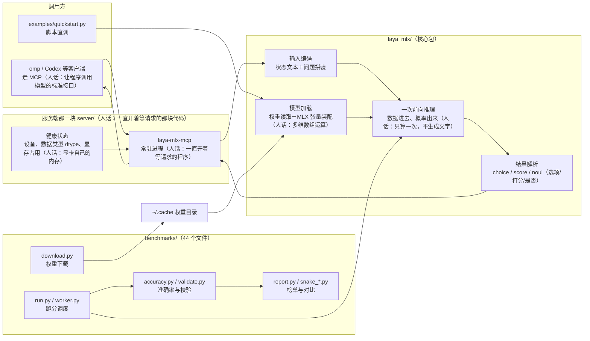
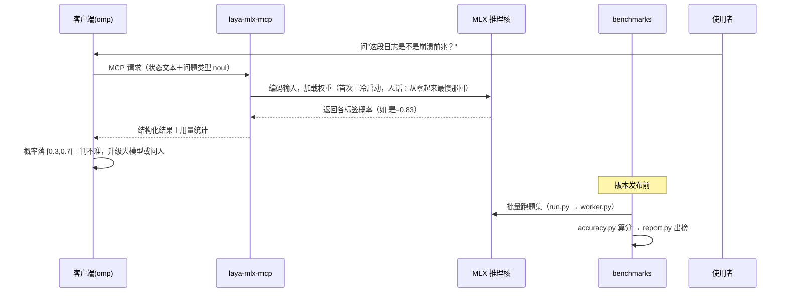

# laya-mlx 架构图与流程图（10-20 补真图）

> 定位：在 Apple 芯片上用 MLX 原生跑 Laya 类型化决策模型（typed decision＝一次前向输出概率而非生成文字）的 Python 包＋MCP 服务。155 个跟踪文件＝`benchmarks/`(44)＋`laya_mlx/`(23)＋`server/`(10)。

## 一、架构图（组件与依赖）



## 二、流程图（一次类型化判断请求）



## 三、关键目录

| 路径 | 作用 |
|---|---|
| `laya_mlx/`(23) | 加载、编码、前向、结果解析 |
| `server/`(10) | MCP 服务进程与健康状态 |
| `benchmarks/`(44) | 下载、跑分、校验、榜单 |
| `experiments/`、`examples/` | 成本/能力实验与快速上手样例 |
| `tests/`(11) | 单元与集成测试 |

## 四、怎么跑 / 怎么验

```bash
uv tool install laya-mlx        # 安装（提供 laya-mlx-mcp 命令）
laya-mlx-mcp --help
bun test                        # 或 python -m pytest tests/
python -m benchmarks.run        # 跑分（需先 download.py 拉权重）
```
