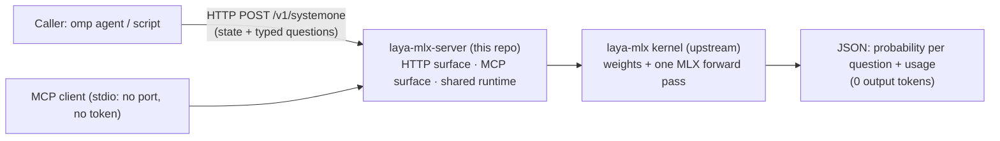
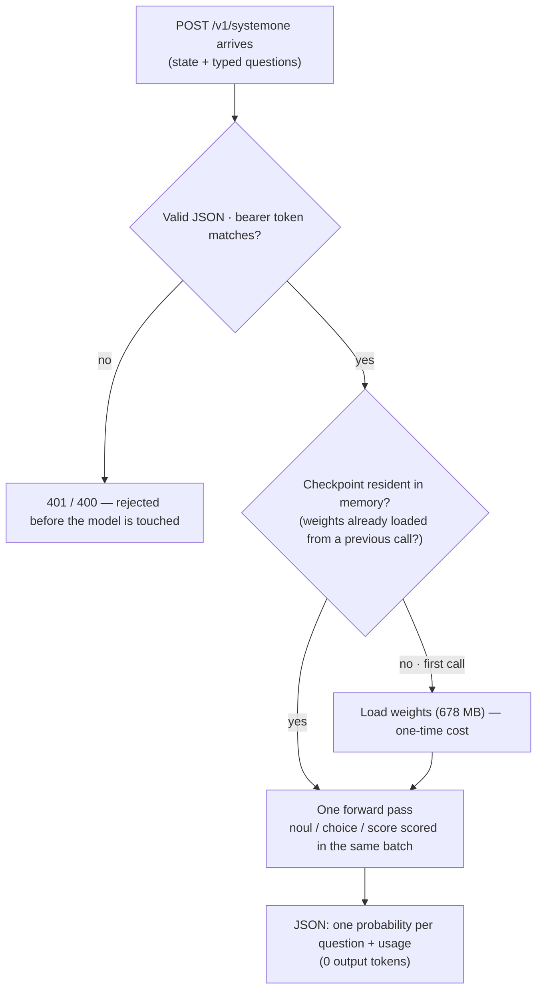
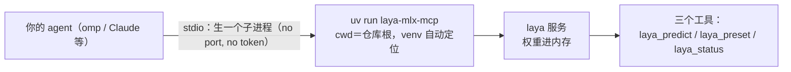

<a href="README.zh-CN.md">简体中文</a> | English

# laya-mlx-server

A service layer on top of [laya-mlx](https://github.com/mizorewww/laya-mlx): **HTTP** speaking the TypeSafe Jev wire protocol, plus **MCP over stdio**, shipped as its own distribution, `laya-mlx-server`. One forward pass per batch of questions, **0 output tokens**, fully local — no PyTorch runtime, no cloud API.

> **Who is this for**: anyone who wants a cheap, fully-local "System One" judge on Apple Silicon — yes/no, pick-one, score-against-rubric — callable over HTTP or MCP by agents and scripts. **Status**: serve layer only; model, weight conversion, benchmarks and the Snake demo stay upstream, deliberately not duplicated.
> **Analogy**: a vending machine bolted onto the Laya model. Upstream is the factory (weights, kernels, benchmarks); this repo is the counter — coin slot (HTTP / MCP stdio), receipt (JSON probabilities).

## 目录（跳转 / Contents）

- [What can I use it for](#what-can-i-use-it-for-30-second-picker)
- [Three steps (copy-paste)](#three-steps-copy-paste)
- [FAQ](#faq-symptom--cause--fix)
- [Usage example](#usage-example)
- [Calling the API](#calling-the-api) · [MCP](#mcp) · [Configuration](#configuration)
- [Measured on this machine](#measured-on-this-machine) · [Picking a checkpoint](#picking-a-checkpoint)
- [Where to look next](#where-to-look-next) · [Quality gates](#quality-gates)

## What can I use it for (30-second picker)

| When you need it | What you run / call | What you get |
|---|---|---|
| A cheap pre-filter for agent actions (block? refund? which team?) | `POST /v1/systemone` with `state` + `questions` | one probability per question: `noul` (yes/no), `choice` (one of `criteria`), `score` (ordinal rubric) — one forward pass, **0 output tokens** |
| Wire it into an agent as MCP tools | `uv run laya-mlx-mcp` (stdio: no port, no token) | `laya_predict` / `laya_preset` / `laya_status` |
| Check readiness before a batch | `GET /health/ready` (not `/health/live`) | whether a checkpoint is resident — the first call pays the model load, so warm it before timing |
| Keep a safety gate off the cloud bill | `make http` → http://127.0.0.1:8080 | local judging, no PyTorch runtime, no cloud API |
| Compare with published numbers | upstream [BENCHMARKS.md](https://github.com/mizorewww/laya-mlx/blob/main/BENCHMARKS.md) | full method and every timing sample (measured on an M3 Max) — not restated here |



**How to read this map (3 sentences)**: ① two front doors (HTTP with bearer token, MCP over stdio) share one runtime, so weights load once and every question batch reuses them. ② The kernel in the middle belongs to upstream — this repo never forks it, so upstream syncs cannot conflict. ③ The only number you get is a probability: cheap first-pass triage, not ground truth.



**How to read this map (3 sentences)**: ① auth and validation run before the model, so junk requests cost no GPU time. ② The first call pays the weight load; every later call reuses the resident checkpoint — warm with `/health/ready` before timing anything. ③ One exit only: probabilities, no generated text — the caller decides what a number means.

## Three steps (copy-paste)

```bash
git clone git@github.com:tankerwng2/laya-mlx-server.git && cd laya-mlx-server
make install     # one venv with laya-mlx + laya-mlx-server
make prefetch    # one-time weights (678 MB) → offline afterwards
make http        # → http://127.0.0.1:8080
```

Success looks like: `curl -s localhost:8080/health/ready` reports a resident checkpoint, and the sample `POST /v1/systemone` below returns one probability per question.

## FAQ (symptom → cause → fix)

| Symptom | Cause | Fix |
|---|---|---|
| Won't install on Intel / Linux | `mlx` publishes darwin/arm64 wheels only | Apple Silicon + macOS 14+ is a hard requirement; no workaround |
| First request is slow, later ones fast | Checkpoint loads lazily on first use | Warm with `GET /health/ready` before measuring; never time against `/health/live` (process up ≠ model resident) |
| `401` from the API | Bearer token missing/mismatched | `-H "Authorization: Bearer $LAYA_API_KEY"`; keep the key in env, never in the repo |
| English prompts score near zero | Every figure here was measured with **Chinese** input; language routing lives upstream | Recalibrate thresholds on your own language before trusting them |
| Probabilities look over-confident | Model output ≠ correctness (see LICENSE note) | Use it as a cheap filter; escalate the boundary band (roughly 0.3–0.7) to a bigger model or a human |

## Usage example

> [!example] Scenario: triage a refund email in one pass, no chat generation
> ```bash
> curl -X POST http://127.0.0.1:8080/v1/systemone \
>   -H "Authorization: Bearer $LAYA_API_KEY" -H 'Content-Type: application/json' \
>   -d '{"state":{"message":"I was charged twice, please refund the duplicate."},
>        "questions":{"refund":{"type":"noul","instructions":"Does the customer want a refund?"},
>                     "dept":{"type":"choice","instructions":"Who should handle this?","criteria":["billing","technical"]}}}'
> ```
> **What you get**: `refund` → yes/no probability, `dept` → probability per department, in one forward pass. Route the ticket mechanically from those numbers; only escalate when a probability sits in the grey band.

## Where to look next

- Model, Python API, quick start = upstream [laya-mlx README](https://github.com/mizorewww/laya-mlx#readme); timings/method = upstream `BENCHMARKS.md`
- Boundary between this repo and upstream = the table below; serve-layer contract tests = 13 tests in this repo
- 中文版=`README.zh-CN.md`；license & attribution notes=`LICENSE`、`NOTICE`

The model, weight conversion, benchmarks and the Snake demo belong to upstream and are deliberately not copied here:

- [Upstream README](https://github.com/mizorewww/laya-mlx#readme) — the model, Python API, quick start
- [BENCHMARKS.md](https://github.com/mizorewww/laya-mlx/blob/main/BENCHMARKS.md) — upstream's full method and every timing sample, measured on an **M3 Max**
- [Snake demo](https://github.com/mizorewww/laya-mlx/blob/main/docs/SNAKE_DEMO.md) · [Snake speed](https://github.com/mizorewww/laya-mlx/blob/main/docs/SNAKE_BENCHMARKS.md) · [Snake optimization](https://github.com/mizorewww/laya-mlx/blob/main/docs/SNAKE_OPTIMIZATION.md)

## Where the boundary is

| This repo | Upstream |
|---|---|
| `server/laya_mlx_server/`: HTTP surface, MCP surface, shared runtime | `laya_mlx/`: model, tokenization, calibration, presets, router, snake |
| `laya-mlx-http` / `laya-mlx-mcp` entry points | `laya-mlx` / `laya-snake` entry points |
| Serve-layer contract tests (13) | Model and kernel tests |

There is **no** serve code inside `laya_mlx/`, so syncing upstream cannot conflict with this package. Currently synced to upstream Laya **0.3.5** (opt-in embedding shortlist, temperature clamping, single-option handling); the pinned revision is `573e5b6`.

## Quick start

Requires **Apple Silicon + macOS 14+** (`mlx` publishes darwin/arm64 wheels only, so this server **cannot** run in a Linux container; on Linux use upstream `laya-serve`), plus [uv](https://docs.astral.sh/uv/) and roughly 1.5 GB of disk.

```bash
git clone git@github.com:tankerwng2/laya-mlx-server.git && cd laya-mlx-server
make install          # one venv with laya-mlx and laya-mlx-server
make prefetch       # one-time weights (678 MB); offline afterwards
make http           # http://127.0.0.1:8080
```

Once published, an environment that already has `laya-mlx` can just `pip install 'laya-mlx-server[mcp]'` without cloning this repository.

## Calling the API

```bash
curl -X POST http://127.0.0.1:8080/v1/systemone \
  -H "Authorization: Bearer $LAYA_API_KEY" -H 'Content-Type: application/json' \
  -d '{"state":{"message":"I was charged twice, please refund the duplicate."},
       "questions":{"refund":{"type":"noul","instructions":"Does the customer want a refund?"},
                    "dept":{"type":"choice","instructions":"Who should handle this?","criteria":["billing","technical","sales"]}}}'
```

> Request shape only. Every figure in this README was measured with **Chinese** input: this English text scores near zero on the default multilingual checkpoint, so send it to `english` instead (see Picking a checkpoint).

`type` takes three values: `noul` (yes/no), `choice` (pick one, labels in `criteria`), `score` (ordinal rubric; `criteria` is an ordered list of level **descriptions**, not min/max).

`GET /health/live` only says the process is up. `GET /health/ready` is the one that says a checkpoint is resident, and returns 503 otherwise.

## MCP

Stdio transport: no port, no token.

From a clone, let `uv` locate the venv so the entry carries no host path:

```json
{ "laya-mlx-server": { "type": "stdio", "command": "uv",
  "args": ["run", "laya-mlx-mcp"], "cwd": "/path/to/laya-mlx-server",
  "env": { "HF_HUB_OFFLINE": "1", "LAYA_MODELS": "multilingual" } } }
```

A bare `"command": "laya-mlx-mcp"` needs `.venv/bin` on `PATH`. `source .venv/bin/activate`
only covers the shell you activated in; a client started from a GUI or a launcher does not
inherit it, and the spawn fails with a plain "command not found". The `uv` form has no such
dependency: `cwd` plus `uv run` resolves the sibling workspace venv on any host.

Three tools: `laya_predict`, `laya_preset` (`triage` / `email` / `guard` / `moderation` / `router`), `laya_status`.



**看图三句话**：① 主干＝agent 按 mcp.json 用 `uv run` 拉起服务，通道＝stdio：不开端口、不发 token；② `cwd` 指仓库根，uv 自己找到 venv，换机器不用改路径；③ 最脆的一跳＝裸 `"command": "laya-mlx-mcp"`：GUI/启动器拉起的客户端不继承你 shell 里 activate 的 PATH，报 command not found——用 uv 形态即愈。

## Configuration

| env var | meaning | default |
|---|---|---|
| `LAYA_HOST` / `LAYA_PORT` | HTTP bind | `127.0.0.1` / `8080` |
| `LAYA_API_KEY` | when set, requires `Authorization: Bearer`; unset means unauthenticated and logs a warning at startup | none |
| `LAYA_MODELS` | checkpoint aliases to preload, comma separated; empty preloads just `multilingual` | `multilingual` |
| `LAYA_PRELOAD` | preload `LAYA_MODELS` at startup; `0`/`false` defers to the first request | on |
| `LAYA_LOG_LEVEL` | log level for the HTTP surface | `info` |
| `LAYA_STATE_MODE` | `flatten` renders object state as `key: value` lines; `json` keeps upstream byte-identical | `flatten` |
| `LAYA_DEVICE` / `LAYA_DTYPE` | `gpu`/`metal`/`cpu`; `float16`/`bfloat16`/`float32` | auto / `float16` |
| `LAYA_BATCH_SIZE` / `LAYA_MAX_LOADED` | questions per forward pass / resident checkpoints | `16` / `2` |
| `HF_HOME` / `HF_ENDPOINT` | checkpoint cache root / mirror endpoint | `~/.cache/huggingface` / `hf-mirror.com` (prefetch) |

**Security:** the HTTP surface binds to `127.0.0.1` by design; do not expose it on a network without a reverse proxy that enforces `LAYA_API_KEY`. Note that `model` in the request body is passed through to the checkpoint loader, so an authenticated caller can name any complete local Laya checkpoint (or HF repo id) and pull it into memory — keep `LAYA_API_KEY` set whenever untrusted local callers exist.

## Measured on this machine

Environment: **Apple M5 Max** (`applegpu_g17s`, 128 GiB unified memory), macOS 27.0, Python 3.13.15, MLX 0.32.2, laya-mlx **0.2.0**. Method is upstream's own `benchmarks.worker` — isolated processes, timing on synchronised GPU completion, downloads and model loading excluded:

| bucket (mlx / float16, multilingual) | P50 / P95 | throughput |
|---|---|---|
| short q=10 | **9.04 / 9.37 ms** | **1108.3 q/s** |
| short q=50 | **37.90 / 41.23 ms** | **1307.0 q/s** |
| long q=1 | **12.05 / 12.70 ms** | 82.9 q/s |
| long q=10 | **160.21 / 469.63 ms** | 51.3 q/s |

> [BENCHMARKS.md](https://github.com/mizorewww/laya-mlx/blob/main/BENCHMARKS.md) states an environment of **M3 Max / macOS 27.2 / Python 3.12.13**, which is not this machine (M5 Max, macOS 27.0, Python 3.13.15), so its figures are not interchangeable with the table above: on the same harness and method this machine measures **9.04 ms** for multilingual f16 short q=10 against 32.92 ms there.

Serve-layer measurements, all with Chinese input on multilingual: `noul` **0.9953**, `dept` → `billing`; unauthenticated request **401**. MCP `triage`: `intent=refund`, `refund_requested` **0.9676**.

## Picking a checkpoint

Multilingual scores **English** short input very low: the same noul measures about **0.01** for `I was charged twice` against about **1.00** for `发票被重复扣款，请退款`. Use the `english` checkpoint for English traffic (`LAYA_MODELS=english`).

## flatten or json

Jev clients send `state` as an object, and `serialize_state` turns it into literal JSON before tokenizing; `flatten` keeps the field names and drops the punctuation. On **0.3.5** multilingual the two modes no longer flip the verdict: a three-field Chinese state measures `noul` **0.9997** flat vs **0.9966** json, both routing to `billing`. The upstream 0.1.0-era English flip (0.16 vs 0.69) does not reproduce. Set `LAYA_STATE_MODE=json` for byte-identical upstream parity.

## Installing from mainland China networks

| symptom | cause | fix |
|---|---|---|
| `uv`/`pip` dependency install: `Connection refused` | uv/reqwest adopt the macOS **system proxy** (a Clash-class client), which is refusing CONNECT to PyPI; curl does not read the system proxy | `make install UV_INDEX=https://pypi.tuna.tsinghua.edu.cn/simple`, or `NO_PROXY='*' make install` |
| `git clone` / `git push` times out | `github.com:443` is unreachable while `api.github.com`, `github.com:22` and `ssh.github.com:443` all connect | use SSH (this repo's remote already is) |
| weights will not download | `huggingface.co` is blocked | `make prefetch` uses `hf-mirror.com` by default; override with `HF_ENDPOINT` |

## Packaging and publish status

The name `laya-mlx-server` is **still free** on PyPI. `make build` is verified: a 20 KB wheel whose metadata reads `Requires-Dist: laya-mlx>=0.1` (the workspace source does not leak into metadata) and which bundles `LICENSE` and `NOTICE`. **Not published** — uploading is a separate step that needs your explicit go-ahead:

```bash
make build
uv publish --publish-dir server/dist     # token generated yourself on pypi.org
```

## Quality gates

`make test` → **155 passed, 1 skipped**, including the thirteen serve-layer contract tests, which need no weights and no network (they pass against an empty `HF_HOME` with `HF_HUB_OFFLINE=1`). `make lint` and `ruff format --check .` are clean. CI runs two legs, `cpu` and `metal`, with `fail-fast: false`, and builds the wheels once on the cpu leg: cpu is bit-exact, metal is the default device and the path real traffic takes. A chunked forward drifts by 1e-4 on Metal because the act head reduces in a different order, so those assertions compare decisions strictly and floats within `2e-4`.

## Attribution and license

Apache-2.0; see [LICENSE](LICENSE) and [NOTICE](NOTICE). The model and pretrained weights are by [Convai Innovations and Laya contributors](https://github.com/NandhaKishorM/laya); prompt construction, output formatting, language routing, email utilities and presets are adapted from upstream `laya` at pin `573e5b6`; the inference kernel is reimplemented in Apple MLX by [laya-mlx](https://github.com/mizorewww/laya-mlx). Model output probabilities are not a guarantee of correctness.
