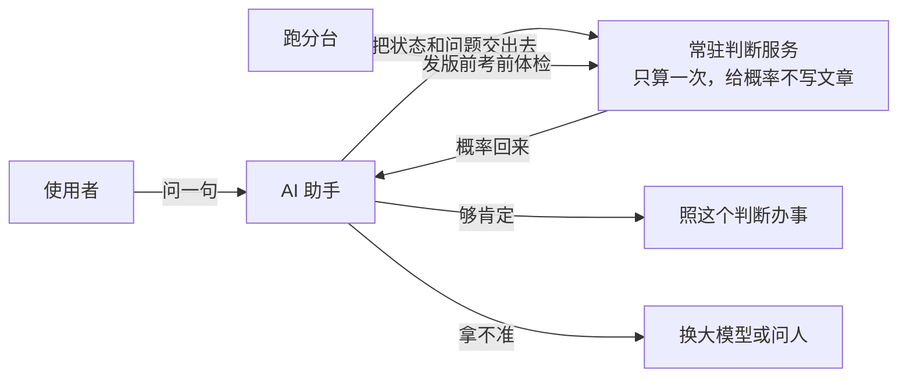
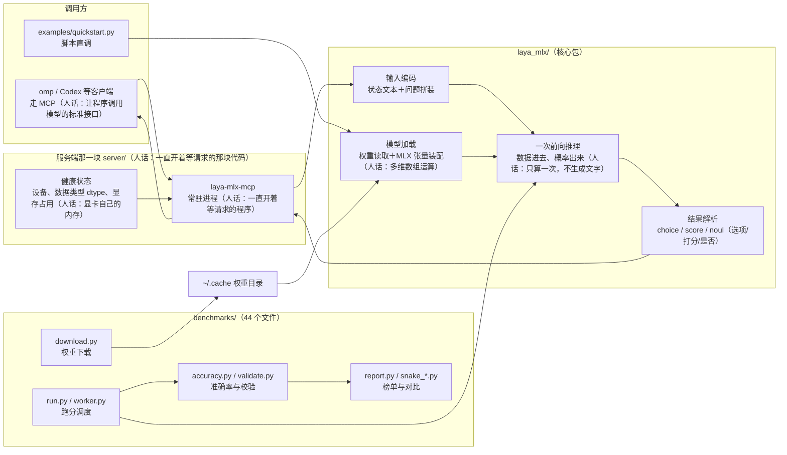
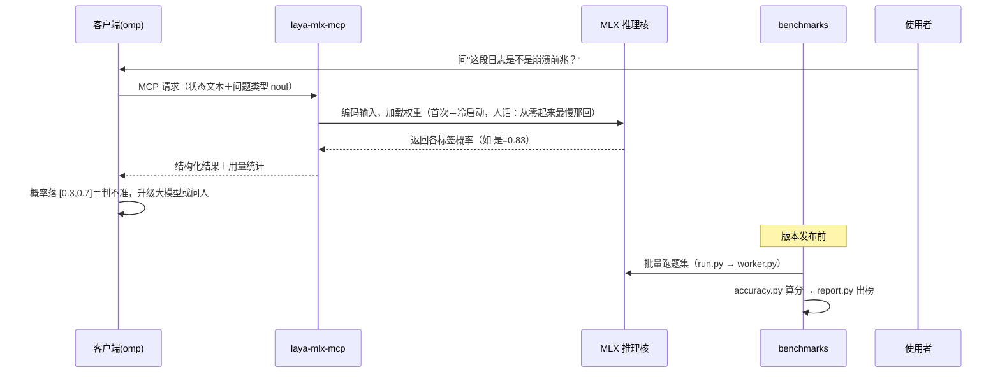

# laya-mlx 架构图与流程图（10-20 补真图）

> 定位：在 Apple 芯片上用 MLX 原生跑 Laya 类型化决策模型（typed decision＝一次前向输出概率而非生成文字）的 Python 包＋MCP 服务。155 个跟踪文件＝`benchmarks/`(44)＋`laya_mlx/`(23)＋`server/`(10)。

## 一、L1 全景图（给小白看）



**看图三句话**：①主干＝使用者问「这段日志是不是崩溃前兆」，AI 助手把状态和问题交给常驻判断服务，一次前向拿回概率。②边界＝概率够用才照办；落在中间拿不准区间（0.3～0.7）就交回大模型或问人，跑分台只在发版前给它体检，不参与线上问答。③最易断＝把小模型给的概率当真理：拿不准区间内的答案被直接照用；服务刚起来那回最慢（冷启动），容易被误判成挂了。
## 二、架构图（组件与依赖）



**看图三句话**：①主干＝omp／Codex 经 MCP 进 `laya-mlx-mcp` 常驻进程，输入编码→一次前向→结果解析（choice／score／noul）再回客户端；权重从 `~/.cache` 装进 MLX 张量，健康状态（设备、dtype、显存）随服务上报。②边界＝`examples/quickstart.py` 走脚本直调、不经 MCP；`benchmarks/` 的 download.py 拉权重、run／worker→accuracy→report 只出榜单，都不碰线上请求路径。③最易断＝前向只算一次，输入编码把状态文本拼错就整体偏；检查点常驻上限 `LAYA_MAX_LOADED`＝2，超了按 LRU 丢最旧，被丢的那个下次要重新加载（最慢那回）。

## 三、流程图（一次类型化判断请求）



**看图三句话**：①主干＝客户端送状态＋问题类型 noul→服务编码并加载权重（首次＝冷启动）→MLX 返回各标签概率（如 是=0.83）→结构化结果加用量统计回到客户端。②产出＝决策权在客户端：概率落 [0.3,0.7] 判不准，升大模型或问人；`benchmarks` 那条线只在版本发布前批量跑题、算分、出榜，与这次请求无关。③最易断＝「首次＝冷启动」那一跳最慢，容易被当超时砍掉；以及概率回来后没人看区间，拿不准的答案被照单执行。

## 四、关键目录

| 路径 | 作用 |
|---|---|
| `laya_mlx/`(23) | 加载、编码、前向、结果解析 |
| `server/`(10) | MCP 服务进程与健康状态 |
| `benchmarks/`(44) | 下载、跑分、校验、榜单 |
| `experiments/`、`examples/` | 成本/能力实验与快速上手样例 |
| `tests/`(11) | 单元与集成测试 |

## 五、怎么跑 / 怎么验

```bash
uv tool install laya-mlx        # 安装（提供 laya-mlx-mcp 命令）
laya-mlx-mcp --help
bun test                        # 或 python -m pytest tests/
python -m benchmarks.run        # 跑分（需先 download.py 拉权重）
```

## 六、镜像层子包 `server/laya_mlx_server/`（10-22 补）

上游只给 MCP（人话：让程序调用模型的标准接口）面；本地镜像这层补了 HTTP 面，omp 的 `jev-gate-local` 才能直接用 TypeSafe Jev wire 协议（人话：一种「状态＋问题 → 概率」的固定报文格式）打本机。

| 文件 | 体量 | 干什么（带行号） |
|---|---|---|
| `__main__.py` | 24 行 | CLI 分发 `python -m laya_mlx_server http\|mcp`（`sub.add_parser` :10-11） |
| `http.py` | 122 行 | FastAPI 应用；路由 `POST /v1/systemone`（:71-72）；Bearer 鉴权走 `hmac.compare_digest`（:30-35） |
| `mcp.py` | 120 行 | MCP stdio 面；`state` 允许纯文本或 JSON 对象（:34-35） |
| `runtime.py` | 215 行 | 共享运行时：模型加载、`flatten_state` 状态展平、`MAX_BODY_BYTES` 请求体上限 |

### 环境变量与默认值（逐条对过代码，10-22）

| 变量 | 默认 | 出处 |
|---|---|---|
| `LAYA_HOST` | `127.0.0.1`（只跟本机说话） | `http.py:111` |
| `LAYA_PORT` | **8080** | `http.py:112` |
| `LAYA_API_KEY` | 未设＝不鉴权，启动时打警告 | `http.py:48,50` |
| `LAYA_LOG_LEVEL` | `info` | `http.py:110,113` |
| `LAYA_PRELOAD` | 真＝启动就把模型热起来 | `http.py:115`、`mcp.py:113` |
| `LAYA_MODELS` | `multilingual` | `runtime.py:15` |
| `LAYA_MAX_LOADED` | `2` 个检查点常驻，超了丢最旧（LRU，人话：最近最少用先淘汰） | `runtime.py:119-120`（`OrderedDict` :47） |
| `LAYA_DEVICE` | `auto`（可 `gpu`/`metal`/`cpu`） | `runtime.py:20` |
| `LAYA_DTYPE` | `float16` | `runtime.py:21` |
| `LAYA_BATCH_SIZE` | `16` 题／次前向 | `runtime.py:22` |
| `LAYA_COMPILE` | `0`（不编译前向路径） | `runtime.py:23` |
| `LAYA_STATE_MODE` | 把 JSON 状态展平成文本再喂模型 | `mcp.py:34-35` |

🔴 端口口径：本包默认 **8080**，跟 oMLX 的 `:8001`、PC vLLM 的 `:8000` 都不同——配 MCP（人话：把服务接到 AI 助手的工具清单里）时别填错。

## 七、文件位置说明（10-22）

本文件原先在仓库根 `ARCHITECTURE.md`（10-20 补图时放错层），现按红线 `architecture-doc` 迁到 `docs/ARCHITECTURE.md`＝闸认的路径（`repo-init.sh check` 查的就是这个位置）。全仓无其它文件引用旧路径，迁移零断链。
